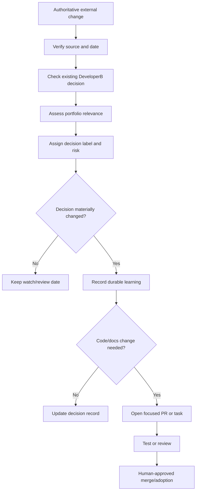

# Continuous Technology Update System

Technology changes often. DeveloperB must stay current without becoming trend-driven, unstable, noisy, or expensive to maintain.

## Simple goal

When a meaningful platform, framework, security, design, agent, automation, search, privacy, infrastructure, or product-pattern change appears, DeveloperB should notice it, verify it, classify its relevance, and prepare a reviewable decision.

It should **not** silently change trusted guidance or adopt technology because it is new.

## Default cadence

Use a **weekly high-signal review** as the normal cadence for broad technology intelligence.

Weekly is preferred because it:
- reduces repeated news and minor version noise;
- makes decision-state changes easier to see;
- gives enough time for primary sources, advisories, patches, and clarifications to appear;
- reduces research/token/API cost;
- encourages durable lessons instead of daily headline accumulation.

Do not wait for the weekly review when a confirmed critical security advisory, active exploitation, provider outage, breaking deprecation deadline, legal/compliance change, or production-impacting platform change requires earlier action.

## What to watch

Prioritize primary and authoritative sources for:

- Cloudflare developer documentation, changelog, blog, Workers SDK/workerd repositories;
- React, Next.js, Node.js, TypeScript, Vite and related official releases;
- GitHub platform, Actions, security, supply-chain and repository-governance changes;
- AI agents, MCP, coding tools, model/platform releases and agent infrastructure;
- databases, ORMs, authentication and authorization;
- browser/testing/observability tooling;
- UI/UX/CX, accessibility and design-system standards;
- SEO, indexing, search-engine and structured-data guidance;
- analytics, social-platform APIs/pixels/policies and email infrastructure;
- privacy/security regulators and standards bodies;
- relevant startup/product patterns when they reveal a real capability or workflow shift.

Use secondary reporting only when primary evidence is unavailable or when independent technical analysis adds material context.

## Signal filter

Do not retain an update merely because it is popular.

Keep it when it can plausibly:

- fix a security/reliability problem;
- reduce cost or repeated work;
- improve user/admin experience;
- improve observability or recovery;
- unlock a missing capability;
- simplify architecture;
- affect compliance or platform policy;
- materially change a current recommendation;
- create a credible product/business opportunity.

Ignore recycled news, rumors, trivial version churn, marketing-only claims, benchmark-only hype, and technology with no plausible portfolio value.

Prefer **3–7 strong signals for a week** over a long list of weak items.

## Decision labels

Every retained signal should receive one label:

| Label | Meaning |
| --- | --- |
| WATCH | Interesting; no action yet |
| RESEARCH | Needs deeper fit/impact analysis |
| TEST | Run a bounded non-production experiment |
| ADOPT | Approved pattern for suitable new work |
| MIGRATE | Existing systems should move after verification |
| AVOID | Known poor fit or unacceptable risk |
| NO ACTION | Understood but irrelevant now |

Record why the label was chosen and what evidence would change it.

## Decision-state transitions

Do not repeat the same news item every week unless its state materially changes.

Examples:

- advance notice of a security release: `WATCH`;
- advisory published with affected versions: `TEST` or `MIGRATE`;
- beta capability becomes stable but no portfolio need exists: remain `WATCH`;
- a tested capability materially improves cost/reliability: `ADOPT`;
- a platform deprecation reaches its blocking date: `MIGRATE` for affected projects;
- a previously interesting tool is superseded or unnecessary: `NO ACTION` or `AVOID`.

The useful unit of intelligence is the **decision change**, not the repeated headline.

## Safe update flow

## What every retained signal should include

- What changed
- Primary source and publication/release date
- Checked date
- Why it matters
- Affected project(s) or project types
- Risk/opportunity
- Confidence
- Decision label
- Previous label/decision when applicable
- Required test/migration if any
- Cost/security/privacy impact where relevant
- Deadline when one exists

## Urgent security and deprecation handling

Treat deadlines explicitly.

For security:
1. record installed/resolved versions;
2. wait for confirmed affected ranges when disclosure is incomplete;
3. once a confirmed critical/high vulnerability applies, prioritize a security-only update;
4. run framework/runtime/adapter/auth/upload/cache regression checks;
5. do not combine emergency patching with unrelated modernization.

For deprecations:
1. distinguish announcement date from enforcement date;
2. identify affected deployed/build environments;
3. migrate before the deadline when failure would block deployment or service;
4. do not change unaffected projects merely for consistency.

## Measure before changing

A platform/search/analytics announcement should usually trigger **measurement first**, not immediate redesign.

Examples:
- search algorithm update → compare Search Console data before rewriting content;
- visual-search reporting → measure discovery before replacing imagery;
- new Core Web Vitals diagnostics → identify the bottleneck before optimizing;
- new error classification → update interpretation before changing infrastructure.

Do not convert correlation into causation.

## Platform-native before custom automation

Before building a new scanner, sandbox, notification worker, merge bot, browser runner, permission layer, or cost monitor, check whether the existing platform already provides the capability with acceptable controls.

Prefer native capability when it:
- reduces maintenance;
- has adequate permission boundaries;
- is observable;
- is reasonably portable or replaceable;
- does not create unacceptable lock-in/cost.

Custom automation is justified when the native option cannot satisfy a real requirement.

## Open-source/repository gate

Before recommending a new repository, package, starter, MCP server, agent framework, or automation tool, inspect:

- license;
- maintenance/release activity;
- maintainer/community health;
- known security concerns;
- dependency footprint;
- compatibility with the intended runtime;
- operational burden;
- data/privacy implications;
- migration/exit cost;
- whether existing/native functionality already solves the problem.

Do not copy a project merely because it is popular. Learn from architecture and patterns while respecting license and protected expression.

## Build and dependency reproducibility

Treat the build environment as part of the deployed artifact.

Track or pin where justified:
- Node/runtime version;
- package manager version;
- framework/adapter version;
- CI action versions;
- important transitive workflow dependencies;
- platform build-image/default changes.

A source tree can be unchanged while its build output changes because the environment changed.

Security and maintenance reviews should therefore inspect both application dependencies and CI/build dependencies.

## Operational visibility dependencies

Notifications, dashboards, telemetry fields, status codes, and provider reporting are dependencies too.

When a platform retires or changes:
- email/push notifications;
- error semantics;
- token/usage headers;
- analytics retention;
- metrics attribution;

verify that monitoring and maintenance workflows still see the events they depend on.

An application can remain online while the team silently loses operational visibility.

## Risk levels

| Level | Meaning | Action |
| --- | --- | --- |
| Low | Small documentation/example improvement | Review normally |
| Medium | Behavior, command, workflow, cost, or recommendation changed | Test before adoption |
| High | Security, breaking change, deprecation, legal/privacy, pricing, auth, production runtime, or destructive migration impact | Explicit human review required |

## What AI may do

AI may:

- scan current authoritative sources;
- summarize meaningful changes;
- compare new evidence with existing decisions;
- identify affected projects;
- suggest bounded experiments;
- propose documentation or code changes;
- create draft/focused PRs;
- mark unclear areas for review.

AI must not:

- auto-merge consequential technology updates;
- invent features, release details, pricing, compatibility, or legal requirements;
- treat preview/beta features as production-safe by default;
- automatically rewrite working architecture because a new tool appeared;
- create uncontrolled scraping/import/publishing loops;
- hide uncertainty or source quality.

## Weekly learning loop

End each useful weekly scan with 1–3 durable lessons.

A durable lesson should:
- remain useful after the original news item is forgotten;
- apply to more than one project or vendor;
- not already be captured in an existing standard;
- improve reliability, cost, security, UX, maintainability, or decision quality.

Examples:

- isolate autonomous execution instead of only reducing permissions;
- treat cost telemetry as operational telemetry;
- route AI tasks by complexity rather than using one expensive model everywhere;
- prefer event-driven monitoring over constant polling when the platform supports it;
- measure before redesigning after search/performance changes;
- treat CI/build dependencies as part of the supply chain;
- keep human approval for irreversible or high-consequence actions.

When a lesson becomes stable and broadly useful, promote it into the appropriate DeveloperB standard instead of leaving it only in a weekly report.

## Beginner rule

A new technology is not automatically required.

If a feature is new, experimental, beta, expensive, operationally complex, or only useful at scale, DeveloperB must say so clearly and provide the simpler default first.
